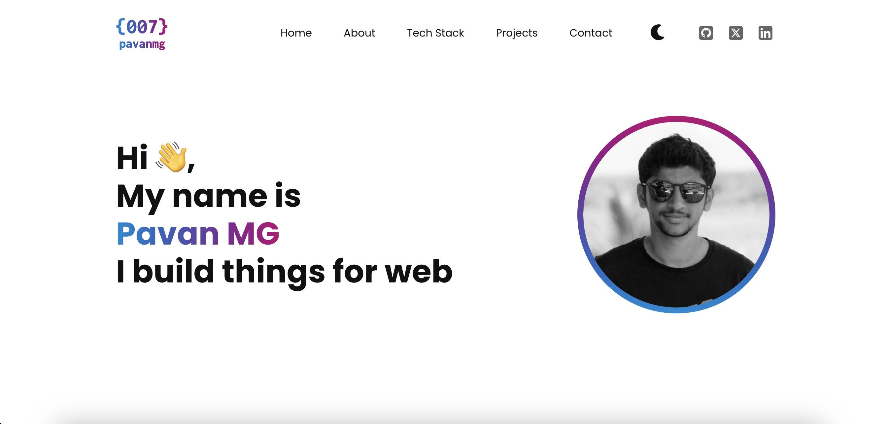
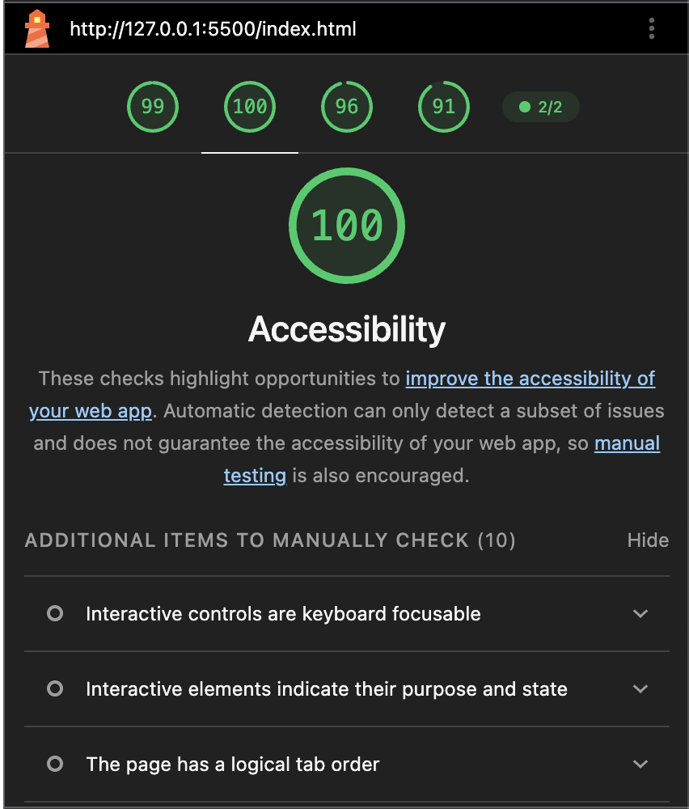

# README – Portfolio för Pavan MG

**Publicerad sida:** [länk här]

---

## Från skiss till kod

Jag började med att dela upp skissen i sektioner: header, hero, about, tech stack, projects, contact och footer i den html semantik jag trodde skulle passa bäst för varje element.
Sedan gick jag över till CSS.

Det svåraste att översätta var **projektkorten**. Skissen visar sex kort där alla ska ha samma höjd oavsett innehållslängd. Jag löste det med `display: grid` på `.article-cards` och `grid-template-rows: subgrid` med `grid-row: span 5` på varje `article`. Inuti korten använde jag ytterligare en `subgrid` på `.article-content` med `grid-row: span 4`. Det gör att text, tech stack och footer hamnar på samma vertikala plats i alla kort utan JavaScript eller fasta höjder.

Ett annat problem var **arbetserfarenhetskorten**. Där ville jag ha företagsnamn och plats på samma rad men med flexibla kolumnbredder. Jag använde `grid-template-columns: repeat(auto-fit, minmax(4rem, 1fr))` på `.grid-align`, och på små skärmar (max 561px) byter jag till `grid-template-columns: 1fr`.

Jag jobbar med **nested CSS** för att hålla ihop struktur och stil. Istället för att skriva `.header .logo p` skriver jag `.logo { p { ... } }` inuti `.header`. Fördelen är att koden blir lättare att läsa och underhålla varje komponents stilar ligger samlade på ett ställe, och jag slipper långa selektorkedjor. Det gör också att jag kan flytta en komponent utan att behöva skriva om alla selektorer.

---

## Semantik

Jag valde HTML-element utifrån innehållets betydelse:

- `<header>` för sidhuvudet med logotyp, navigation och dark mode-toggle.
- `<nav>` för både huvudnavigation och sociala länkar, med `aria-label` för att skilja dem åt.
- `<main>` för allt huvudinnehåll.
- `<section>` för varje innehållsblock.
- `<article>` för varje projektkort och arbetserfarenhet de är självständiga enheter.
- `<figure>` runt projektbilderna.
- `<time datetime="...">` för datumintervallen.
- `<address>` för e-postadressen.
- `<footer>` för sidfoten.

Jag landade i `
` där inget bättre fanns: `.mobile-nav`, `.nav-container`, `.card-content` och `.grid-align`. Dessa är rent layoutmässiga och har ingen semantisk betydelse.

---

## Layout

**Flexbox** använde jag där innehållet ska flöda i en riktning:

- `.header` – `justify-content: space-between`.
- `.nav-links ul` och `.social-links ul` horisontella listor med `gap`.
- `.hero-section` – text och bild sida vid sida.
- `.card-content` – titel och badge.

**Grid** använde jag där jag behövde tvådimensionell kontroll:

- `.article-cards` – `repeat(auto-fit, minmax(min(300px, 100%), 1fr))` skapar ett responsivt rutnät. `min(300px, 100%)` säkerställer att korten aldrig blir bredare än skärmen.
- `.mystack-gallery` – `repeat(6, 1fr)` i desktop, `repeat(4, 1fr)` under 800px och `repeat(3, 1fr)` under 426px.
- `.grid-align` – `repeat(auto-fit, minmax(4rem, 1fr))`.
- `subgrid` – för att synka rader mellan korten.

Jag jobbar med **container/element-driven breakpoints** istället för globala brytpunkter. Varje komponent bryter när den behöver, baserat på sitt eget innehåll och sin egen layout inte vid en godtycklig skärmstorlek som delas av hela sidan. Fördelen är att varje komponent kan anpassas efter sina egna behov. Tech stack-galleriet bryter vid 800px för att ikonerna blir för små, medan headern bryter vid 921px för att navigation, dark mode och sociala länkar inte längre får plats på en rad. Arbetserfarenhetskorten bryter vid 561px för att texten annars radbryts fult. Istället för att tvinga in allt i samma brytpunkter låter jag varje komponent bestämma själv. Det gör sidan mer robust om jag ändrar en komponents innehåll behöver jag bara justera just den komponentens brytpunkt, inte hela sidans.

---

## Tillgänglighet

- **Semantisk HTML** – skärmläsare kan navigera mellan sektioner, artiklar och navigation.
- **ARIA-attribut** – `aria-label` på hamburgarmenyn, `aria-expanded` och `aria-controls`.
- **Alt-text** på profilbilden och projektbilderna.
- **Fokus-visible** – `:focus-visible { outline-offset: 0.2rem; }` i `reset.css`.
- **`prefers-color-scheme`** – via `color-scheme: light` och `light-dark()` fungerar sidan i både ljust och mörkt läge.
- **`text-size-adjust: none`** – förhindrar att mobilwebbläsare förstorar texten.
- **`overflow-wrap: break-word`** – förhindrar att långa ord spränger layouten.

Jag testade med och **Lighthouse**. Lighthouse gav 100 i Accessibility.

**Vad som återstår:** Hamburgarmenyn är inte funktionell den visas men öppnar ingen meny. Jag skulle behöva JavaScript för att toggla en klass på navigationen.

---

## Användbarhet

Designen följer flera UX-principer:

- **Visuell hierarki** – stora rubriker och tydliga sektioner.
- **Konsekvent layout** – samma maxbredd och spacing-system genom hela sidan.
- **Återkoppling** – hover-effekter på länkar och dark mode-toggle.
- **Mobil-layout** – responsiv layout.

Jag hade **gjort annorlunda**:

- Projektkortens höjd är beroende av `subgrid`, vilket fungerar bra i moderna webbläsare men kan vara svårt att förstå. Jag hade kunnat använda `align-items: stretch` på en flex-container istället.
- Hamburgerikonen är inte animerad till ett kryss när menyn är öppen en vanlig UX-detalj jag skulle lägga till.

---

## Styrkor och brister

**Styrkor:**

- Den container/element-drivna brytpunktsfilosofin gör att varje komponent känns genomtänkt för flera skärmar.
- Användningen av `subgrid` för projektkorten löser ett klassiskt problem med ojämna kort.
- CSS-variablerna i `:root` gör färger, spacing typografi konsekventa.
- Semantisk HTML med genomtänkta elementval.

**Brister:**

- Hamburgarmenyn är inte funktionell.
- Dark mode-toggle använder en checkbox-hack som fungerar men inte är den mest robusta lösningen.

**Med mer tid** skulle jag bygga om hamburgarmenyn med JavaScript vilket kommer i nästa uppgift.

---

## AI-verktyg

Jag använde AI för att **felsöka `subgrid`** – AI förklarade hur `grid-template-rows: subgrid` fungerar och varför det löser höjdproblemet. Jag fick en tydlig förklaring och kunde sedan applicera det själv i koden.

Det negativa var att AI ville använda **globala brytpunkter** (768px, 1024px). Jag bytte till container/element-drivna brytpunkter baserat på innehållet, eftersom globala brytpunkter inte tar hänsyn till att olika komponenter har olika behov.